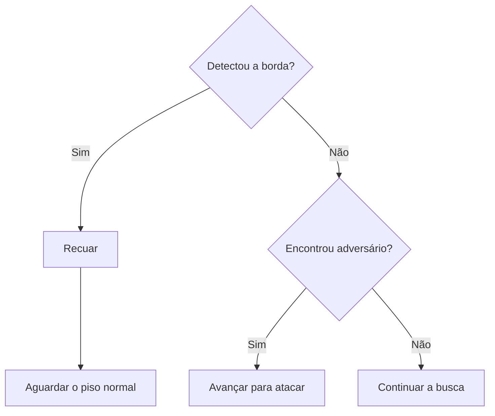

# 🤖 SUMOBOT ARENA

### Perceber a arena. Encontrar o alvo. Reagir.

Robô sumô autônomo com Arduino, sensores infravermelhos e ultrassom.

---

## O projeto

O **SumoBot Arena** é um robô sumô autônomo programado em C++ para Arduino. Ele utiliza sensores infravermelhos para reconhecer a borda e um sensor ultrassônico para localizar o adversário, controlando dois motores DC por uma ponte H.

| 🛡️ Borda | 🎯 Ataque | 🔎 Busca |
|:---:|:---:|:---:|
| Recua ao detectar a linha | Avança conforme a distância | Alterna avanços e giros |
| **Prioridade 1** | **Prioridade 2** | **Prioridade 3** |

## Como funciona

1. **Partida:** pressione e solte o botão. O robô aguarda 5 segundos e calibra os sensores sobre o piso normal da arena.
2. **Abertura:** avança por 1,5 s e gira à direita por 1,2 s.
3. **Busca e ataque:** procura o adversário e avança quando ele está a até 40 cm.
4. **Borda:** interrompe o movimento, recua por 1,5 s e aguarda o piso normal antes de retomar a busca.

### Lógica de busca e ataque

O fluxograma resume as decisões **após a abertura**. O robô repete essas verificações durante a operação; após recuar, aguarda o piso normal antes de retomar a busca. A borda também pode interromper a abertura; o ultrassônico começa a comandar ataques no modo de busca.

### Velocidades de ataque

| Nível | Distância | PWM esquerdo / direito |
|---|---|:---:|
| 🟢 Leve | Mais de 25 cm até 40 cm | 128 / 128 |
| 🟡 Médio | Mais de 10 cm até 25 cm | 190 / 190 |
| 🔴 Máximo | Mais de 0 cm até 10 cm | 255 / 255 |

Sem leitura válida do alvo, o robô executa a varredura: **frente → direita → esquerda → frente → esquerda → direita**.

## Conexões

<b>🔌 Ver tabela de pinos</b>

| Componente | Pino Arduino |
|---|:---:|
| Botão de partida | 2 |
| Ponte H — motor esquerdo, A / B | 5 / 6 |
| Ultrassônico — ECHO / TRIG | 7 / 8 |
| Ponte H — motor direito, A / B | 9 / 10 |
| Sensor de linha direito — DO | 11 |
| Sensor de linha esquerdo — DO | 12 |
| Sensor de linha traseiro — DO | 13 |

O botão conecta o **pino 2 ao GND** ao ser pressionado (`INPUT_PULLUP`). Os motores são ligados à ponte H; os pinos de controle precisam oferecer PWM na placa utilizada.

## Como executar

1. Baixe [`SumoBot_Arena.ino`](SumoBot_Arena.ino) e coloque-o em uma pasta chamada `SumoBot_Arena`.
2. Abra na **Arduino IDE**, selecione a placa e a porta e envie o programa.
3. Para acompanhar as leituras, abra o **Monitor Serial em 9600 baud**.
4. Posicione os sensores sobre o piso normal da arena e pressione e solte o botão.

**Não requer bibliotecas externas.** A calibração leva aproximadamente 0,5 s após a contagem de 5 s.

## Ajustes principais

| O que ajustar | Onde alterar no código |
|---|---|
| Velocidade dos motores | Seção **2. VELOCIDADES** — valores de 0 a 255 |
| Duração dos movimentos | Seção **3. TEMPOS** — valores em milissegundos |
| Distâncias de ataque | `executarAtaque()` e limite geral em `atualizarUltrassonico()` |
| Contagem de partida | Laço de contagem em `setup()`; `TEMPO_INICIO` não é utilizado |

> **Sobre esta versão:** o sensor traseiro é calibrado, mas ainda não aciona manobras. Os giros são estimados por tempo, sem medição do ângulo real.

---

**SUMOBOT ARENA** · Arduino & C++

[Ver código-fonte](SumoBot_Arena.ino) · [Repositório](https://github.com/diohide/SumoBot-Arena)

